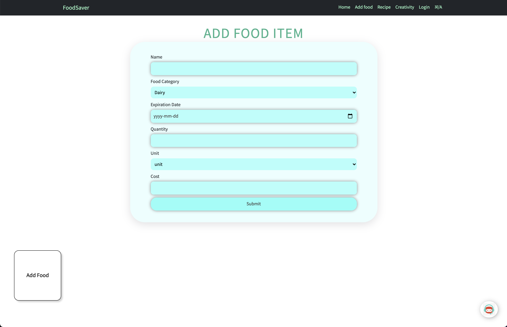
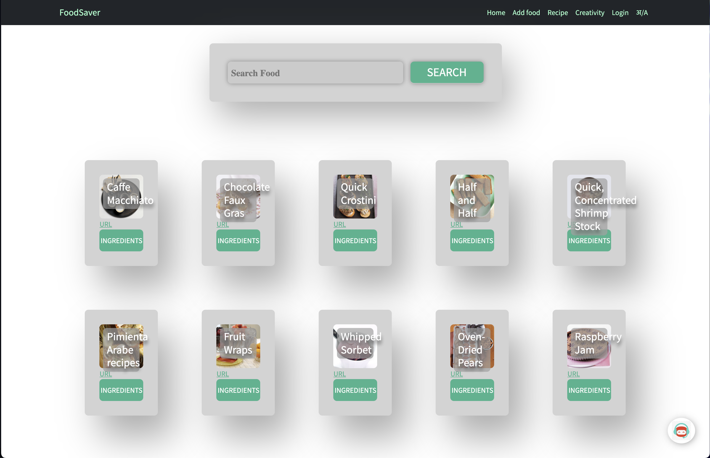
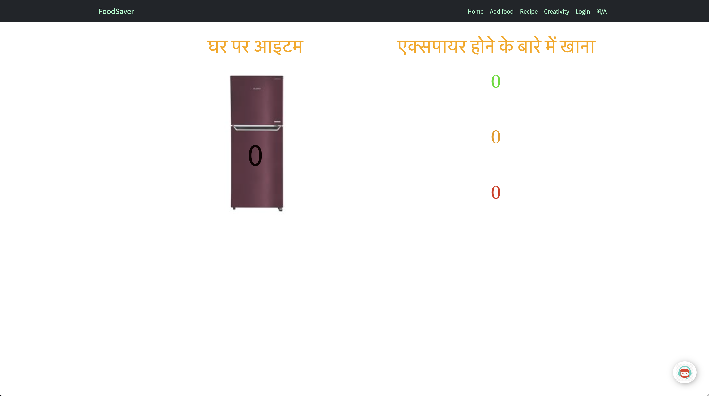
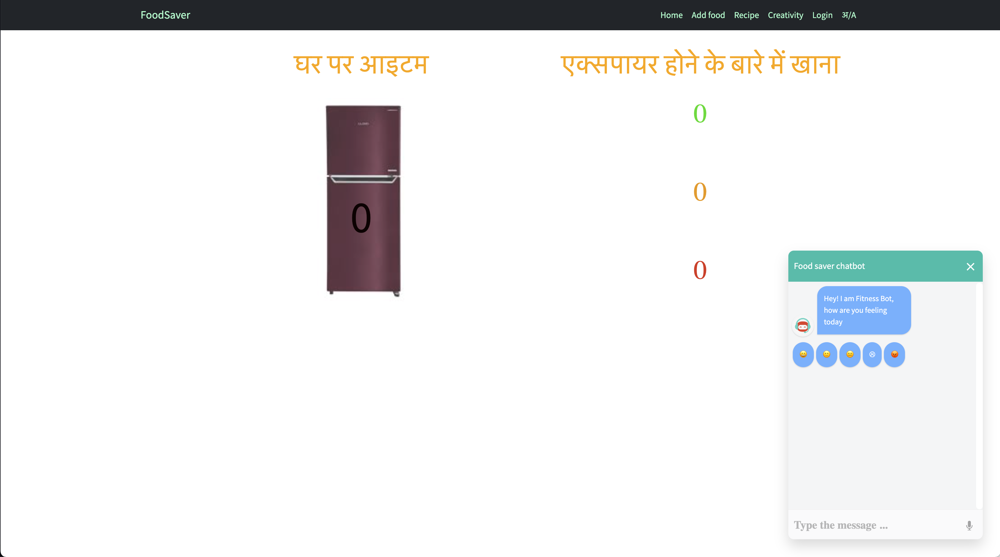

# 🍎 FoodSaver - Reduce Food Waste, Save Money & Environment

[](https://github.com/mohit200008/FoodSaver20008/pulls)
[](https://github.com/ellerbrock/open-source-badges/)
[](https://github.com/mohit200008/FoodSaver20008)

> **Food waste contributes to 6% of global greenhouse gas emissions.** FoodSaver helps you track food items, get expiration alerts, and discover recipes to reduce waste and save money.

## 📋 Table of Contents

- [🌍 About](#-about)
- [✨ Features](#-features)
- [🖼️ Screenshots](#️-screenshots)
- [🚀 Quick Start](#-quick-start)
- [🛠️ Technology Stack](#️-technology-stack)
- [📱 Features in Detail](#-features-in-detail)
- [🔧 Installation](#-installation)
- [🌐 Environment Setup](#-environment-setup)
- [📖 Usage Guide](#-usage-guide)
- [🤝 Contributing](#-contributing)
- [🔮 Future Roadmap](#-future-roadmap)
- [📄 License](#-license)

## 🌍 About

FoodSaver is a comprehensive web application designed to combat food waste by providing intelligent food tracking, expiration alerts, and recipe suggestions. With the global food waste crisis contributing significantly to environmental damage, this application offers a practical solution for households and restaurants.

### 🎯 Mission
- **Reduce Food Waste**: Track and manage food items before they expire
- **Save Money**: Prevent unnecessary grocery spending
- **Protect Environment**: Reduce greenhouse gas emissions from food waste
- **Help Communities**: Minimize waste that could feed those in need

## ✨ Features

### 🥘 Core Functionality
- **Smart Food Tracking**: Add, edit, and monitor food items with expiration dates
- **Expiration Alerts**: Get timely notifications before food expires
- **Recipe Suggestions**: Discover recipes using available ingredients
- **Multi-language Support**: Available in English and Hindi
- **Interactive Chatbot**: AI-powered assistant for food management tips

### 🎨 User Experience
- **Responsive Design**: Works seamlessly on desktop, tablet, and mobile
- **Intuitive Interface**: Easy-to-use dashboard with card-based layout
- **Custom Scrollbar**: Enhanced visual experience
- **Real-time Updates**: Instant synchronization across the application

### 🔐 Security & Performance
- **User Authentication**: Secure login/signup with OTP verification
- **Data Persistence**: Reliable storage and retrieval of food data
- **API Integration**: Seamless backend communication

## 🖼️ Screenshots

| Feature | Screenshot |
|---------|------------|
| **Home Page** |  |
| **Add Food Item** |  |
| **Recipe Suggestions** |  |
| **Multi-language Support** |  |
| **Smart Chatbot** |  |

## 🚀 Quick Start

### Prerequisites
- [Node.js](https://nodejs.org/) (v14 or higher)
- [npm](https://www.npmjs.com/get-npm) (v6 or higher)

### Installation
```bash
# Clone the repository
git clone https://github.com/mohit200008/FoodSaver20008.git

# Navigate to project directory
cd FoodSaver20008

# Install dependencies
npm install --legacy-peer-deps

# Start the development server
npm start
```

The application will be available at `http://localhost:3000`

## 🛠️ Technology Stack

### Frontend
- **React.js** (v16.10.2) - User interface framework
- **React Router DOM** - Client-side routing
- **Bootstrap** (v5.1.3) - CSS framework
- **Styled Components** - Component styling
- **Axios** - HTTP client for API calls

### Additional Libraries
- **React Simple Chatbot** - Interactive chatbot component
- **Victory.js** - Data visualization charts
- **React Bootstrap** - Bootstrap components for React
- **OTP Input React** - OTP verification components

### Development Tools
- **React Scripts** - Build and development tools
- **ESLint** - Code quality and consistency
- **Webpack** - Module bundler

## 📱 Features in Detail

### 🥘 Food Management System
- **Add Food Items**: Input food name, quantity, and expiration date
- **Edit Items**: Modify existing food entries
- **Delete Items**: Remove expired or consumed items
- **Expiration Tracking**: Automatic calculation of days until expiration
- **Visual Indicators**: Color-coded cards for different expiration states

### 🍳 Recipe Integration
- **Ingredient Matching**: Find recipes based on available ingredients
- **Recipe Database**: Access to extensive recipe collection
- **Step-by-step Instructions**: Detailed cooking guidance
- **Nutritional Information**: Health and dietary information

### 🤖 Smart Chatbot
- **Food Management Tips**: Get advice on food storage and preservation
- **Recipe Recommendations**: Ask for cooking suggestions
- **Expiration Reminders**: Chat-based notification system
- **Interactive Learning**: Educational content about food waste

### 🌐 Multi-language Support
- **English Interface**: Primary language support
- **Hindi Interface**: Regional language accessibility
- **Seamless Switching**: Easy language toggle
- **Localized Content**: Culturally relevant information

## 🔧 Installation

### Step 1: Clone Repository
```bash
git clone https://github.com/mohit200008/FoodSaver20008.git
cd FoodSaver20008
```

### Step 2: Install Dependencies
```bash
npm install --legacy-peer-deps
```

> **Note**: We use `--legacy-peer-deps` to resolve dependency conflicts between `react-simple-chatbot` and `styled-components`.

### Step 3: Start Development Server
```bash
npm start
```

### Step 4: Access Application
Open your browser and navigate to `http://localhost:3000`

## 🌐 Environment Setup

### API Configuration
To use recipe features, you'll need to set up API credentials:

1. **Get API Keys**: Visit [Edamam](https://www.edamam.com/) to obtain your API credentials
2. **Create Environment File**: Create a `.env` file in the root directory
3. **Add Credentials**:
   ```env
   REACT_APP_APP_ID=your_edamam_app_id
   REACT_APP_APP_KEY=your_edamam_app_key
   ```

### Environment Variables
| Variable | Description | Required |
|----------|-------------|----------|
| `REACT_APP_APP_ID` | Edamam API Application ID | Yes (for recipes) |
| `REACT_APP_APP_KEY` | Edamam API Application Key | Yes (for recipes) |

## 📖 Usage Guide

### Getting Started
1. **Launch Application**: Open `http://localhost:3000` in your browser
2. **Create Account**: Sign up for a new account or log in
3. **Add Food Items**: Click "Add Food" to input your food inventory
4. **Set Expiration Dates**: Specify when each item expires
5. **Monitor Dashboard**: View all items and their expiration status

### Managing Food Items
- **Add New Item**: Use the "Add Food" button to input new items
- **Edit Existing**: Click on any food card to modify details
- **Delete Items**: Remove items that have been consumed or expired
- **Track Expiration**: Monitor the countdown to expiration dates

### Using Recipe Features
- **Browse Recipes**: Explore recipe suggestions based on available ingredients
- **Filter Options**: Use filters to find specific types of recipes
- **Save Favorites**: Bookmark recipes for future reference
- **Share Recipes**: Share cooking inspiration with others

### Chatbot Assistance
- **Ask Questions**: Interact with the chatbot for food management tips
- **Get Recommendations**: Receive personalized advice
- **Learn More**: Access educational content about food waste

## 🤝 Contributing

We welcome contributions from the community! Here's how you can help:

### 🚀 Quick Contribution Steps

1. **Fork the Repository**
   ```bash
   # Click the Fork button on GitHub, then clone your fork
   git clone https://github.com/YOUR_USERNAME/FoodSaver20008.git
   cd FoodSaver20008
   ```

2. **Set Up Upstream**
   ```bash
   git remote add upstream https://github.com/mohit200008/FoodSaver20008.git
   ```

3. **Create Feature Branch**
   ```bash
   git checkout -b feature/your-feature-name
   ```

4. **Make Changes & Commit**
   ```bash
   # Make your changes
   git add .
   git commit -m "feat: add your feature description"
   ```

5. **Push & Create Pull Request**
   ```bash
   git push origin feature/your-feature-name
   # Create PR on GitHub
   ```

### 📋 Contribution Guidelines

- **Code Style**: Follow existing code formatting and ESLint rules
- **Testing**: Test your changes thoroughly before submitting
- **Documentation**: Update documentation for new features
- **Screenshots**: Include screenshots for UI changes
- **Commit Messages**: Use clear, descriptive commit messages

### 🐛 Reporting Issues

- **Bug Reports**: Include steps to reproduce and expected behavior
- **Feature Requests**: Describe the feature and its benefits
- **Screenshots**: Attach relevant screenshots when applicable

## 🔮 Future Roadmap

### 🚀 Upcoming Features
- **Receipt Scanner**: Upload grocery receipts for automatic food addition
- **Mobile App**: React Native application for better mobile experience
- **Cross-platform**: Desktop application for offline use
- **Advanced Alerts**: Push notifications and email reminders
- **Enhanced Chatbot**: AI-powered food management assistant

### 🔧 Technical Improvements
- **Performance Optimization**: Faster loading and better responsiveness
- **Database Integration**: Persistent data storage
- **API Enhancements**: More recipe sources and food databases
- **Security Upgrades**: Enhanced authentication and data protection

### 🌍 Impact Goals
- **User Base**: Reach 10,000+ active users
- **Waste Reduction**: Help users reduce food waste by 50%
- **Community**: Build a supportive community of food-conscious users
- **Education**: Provide educational content about sustainable living

## 📄 License

This project is licensed under the MIT License - see the [LICENSE](LICENSE) file for details.

## 🙏 Acknowledgments

- **Edamam API**: Recipe and nutrition data
- **React Community**: Excellent documentation and support
- **Open Source Contributors**: Everyone who has contributed to this project
- **Environmental Organizations**: Inspiration for creating positive impact

---

<div align="center">

**Made with ❤️ for a sustainable future**

[](https://github.com/mohit200008/FoodSaver20008/stargazers)
[](https://github.com/mohit200008/FoodSaver20008/network)
[](https://github.com/mohit200008/FoodSaver20008/issues)

</div>
